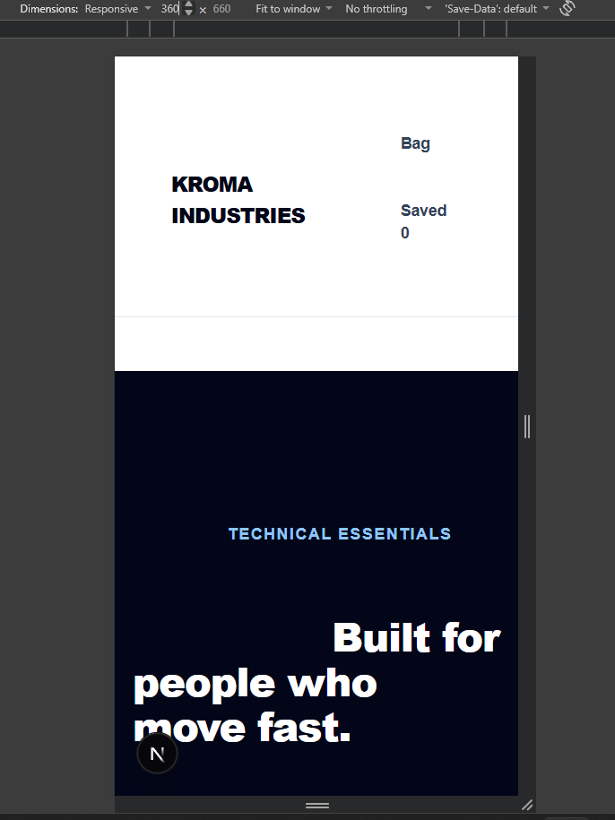
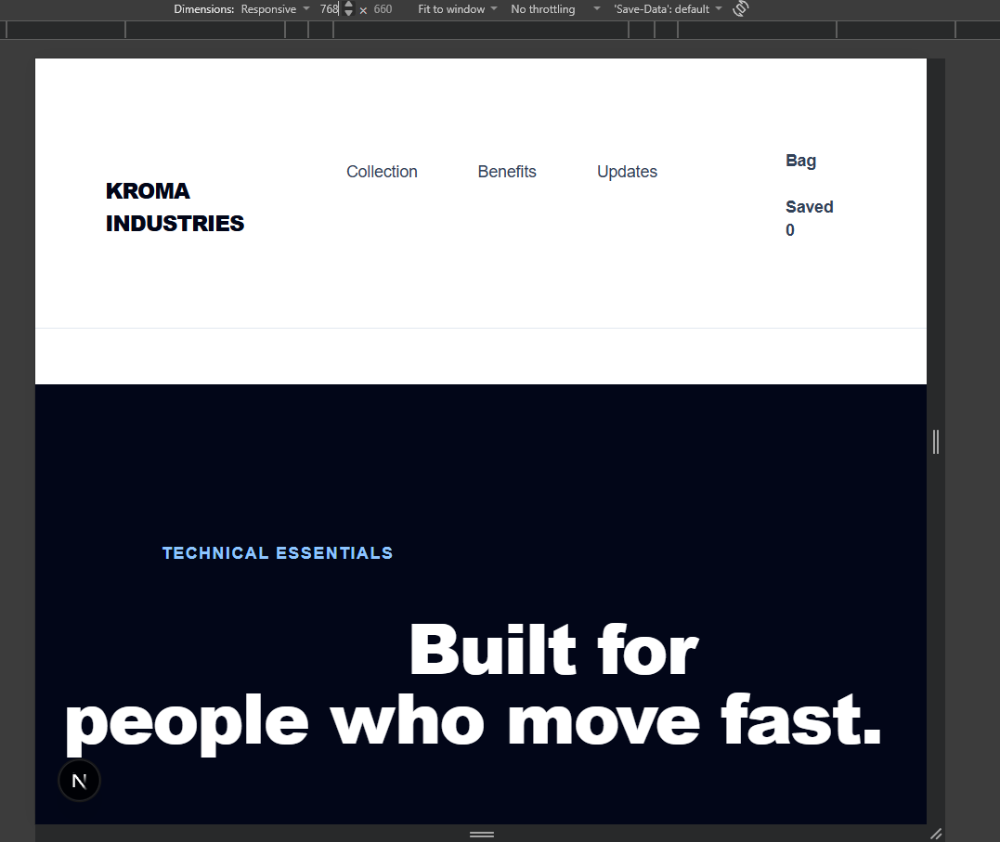
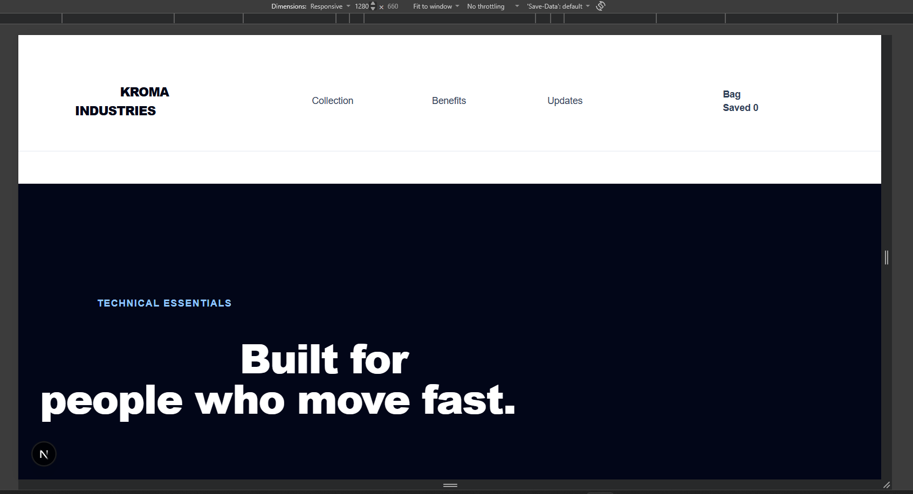

# Dokumen Teknis Modul 2 — HTML Semantik, Tailwind CSS, dan Aksesibilitas

Nama/NIM : **Andhika Abdu Raafi Wicaksono - 105224023**  
Repositori : **https://github.com/dhikaabdu/Modul1-praktikumPemweb**

## 1. Struktur Semantik

### 1.1 Kerangka landmark dan hierarki judul halaman utama

Halaman utama menggunakan elemen HTML semantik untuk membedakan bagian navigasi, konten utama, dan informasi penutup. Struktur yang diterapkan pada `app/page.tsx` adalah:

```text
<header>
└── navigasi utama

<main id="main-content">
├── <section id="top" aria-labelledby="hero-title">
│   └── <h1 id="hero-title">Built for people who move fast.</h1>
│
├── <section id="benefits" aria-labelledby="benefits-title">
│   ├── <h2 id="benefits-title">Designed for everyday performance</h2>
│   └── <article> ... </article>
│       <article> ... </article>
│       <article> ... </article>
│
├── <section id="collection" aria-labelledby="collection-title">
│   ├── <h2 id="collection-title">Shop the essentials</h2>
│   └── <article> ... </article> untuk setiap produk
│
└── <section id="newsletter" aria-labelledby="newsletter-title">
    └── <h2 id="newsletter-title">Get product updates</h2>

<footer>
└── informasi hak cipta dan tautan
```

Selain struktur tersebut, halaman menyediakan tautan **Skip to main content** dengan target `#main-content`. Tautan ini menggunakan `sr-only` dan ditampilkan ketika memperoleh fokus dengan `focus:not-sr-only`, sehingga pengguna keyboard dapat melewati navigasi dan langsung menuju konten utama.

Hierarki heading yang digunakan adalah:

- `<h1>`: **Built for people who move fast.**
- `<h2>`: **Designed for everyday performance**
- `<h2>`: **Shop the essentials**
- `<h2>`: **Get product updates**
- `<h3>`: judul masing-masing benefit dan judul produk.

Elemen `<section>` diberi `aria-labelledby` yang mengarah ke heading masing-masing section. Dengan demikian, section mempunyai nama yang dapat dikenali pada accessibility tree.

### 1.2 Accessibility Tree


Pada screenshot Accessibility Tree terlihat struktur utama halaman berupa `banner`, `navigation`, `main`, beberapa `region`, dan `contentinfo`. Screenshot juga memperlihatkan link **Skip to main content**, identitas **KROMA INDUSTRIES**, navigasi **Primary navigation**, serta region dengan nama **Built for people who move fast**, **Designed for everyday performance**, **Shop the essentials**, dan **Get product updates**.

Struktur tersebut sesuai dengan penggunaan `header`, `nav`, `main`, `section` ber-`aria-labelledby`, dan `footer` pada source code.

---

## 2. Tata Letak Responsif

### 2.1 Tampilan 360 px



Pada screenshot 360 px, halaman berada pada mode layar kecil. Navigasi utama tidak ditampilkan karena menggunakan class `hidden sm:flex`. Area header tetap menampilkan identitas **KROMA INDUSTRIES** dan informasi bag/saved. Hero section menggunakan ukuran heading dasar `text-4xl` dan padding dasar `px-4 py-16`.

### 2.2 Tampilan 768 px



Pada screenshot 768 px, breakpoint `sm` sudah aktif. Navigasi **Collection**, **Benefits**, dan **Updates** mulai tampil. Identitas produk dan informasi bag tetap tersusun dalam satu baris header. Hero menggunakan ukuran heading `sm:text-6xl`.

### 2.3 Tampilan 1280 px



Pada screenshot 1280 px, breakpoint `lg` juga aktif. Layout menggunakan batas lebar `max-w-7xl`, padding horizontal `lg:px-8`, dan beberapa bagian menggunakan perubahan layout mulai `lg`, seperti bagian collection dan footer.

### 2.4 Kelas Flexbox

Beberapa penerapan Flexbox pada `app/page.tsx` adalah sebagai berikut:

| Class | Penerapan | Alasan |
|---|---|---|
| `flex` | Header, tombol hero, daftar kategori, kartu produk, newsletter, footer | Menyusun elemen dalam satu dimensi. |
| `items-center` | Container header dan beberapa kelompok elemen | Menyamakan posisi elemen pada cross axis. |
| `justify-between` | Container header dan area informasi produk | Memberi ruang di antara kelompok elemen. |
| `flex-col` | Container collection, newsletter, footer | Menyusun elemen secara vertikal pada ukuran dasar. |
| `flex-wrap` | Tombol kategori | Memungkinkan tombol berpindah baris ketika ruang tidak cukup. |
| `sm:flex-row` | Newsletter dan footer | Mengubah susunan dari kolom menjadi baris mulai breakpoint `sm`. |
| `lg:flex-row` | Header bagian collection | Mengubah susunan konten collection menjadi baris pada layar besar. |
| `gap-*` | Berbagai container Flexbox | Memberikan jarak antar-elemen tanpa margin individual. |

Flexbox digunakan terutama untuk navigasi/header, kelompok tombol, kontrol collection, newsletter, dan footer karena elemen pada bagian tersebut perlu disusun dalam satu arah dan diratakan pada sumbu utama maupun sumbu silang.

### 2.5 Kelas Grid

Grid digunakan pada bagian yang mempunyai kebutuhan susunan kolom, terutama kartu benefit, kontrol pencarian/sortir, dan kartu produk.

| Class | Penerapan | Alasan |
|---|---|---|
| `grid` | Container benefit, kontrol collection, daftar produk | Mengaktifkan CSS Grid. |
| `grid-cols-*` | Tidak menggunakan `grid-cols-*` eksplisit pada bagian benefit/produk | Jumlah kolom pada source code diatur oleh breakpoint `md:grid-cols-3`, `sm:grid-cols-2`, dan `lg:grid-cols-4`. |
| `md:grid-cols-3` | Tiga kartu benefit pada layar mulai `md` | Menyusun tiga benefit dalam tiga kolom pada layar yang lebih lebar. |
| `sm:grid-cols-2` | Kontrol search/sort dan kartu produk | Membuat dua kolom mulai breakpoint `sm`. |
| `lg:grid-cols-4` | Daftar produk | Menampilkan empat kartu produk per baris pada layar besar. |
| `gap-6` / `gap-4` | Container Grid | Memberikan jarak antar-item Grid. |

### 2.6 Breakpoint yang Digunakan

Breakpoint Tailwind yang terlihat pada source code adalah:

| Breakpoint | Class aktual | Perubahan |
|---|---|---|
| Dasar/mobile | tanpa prefix | Layout dasar untuk layar kecil. |
| `sm` | `sm:flex`, `sm:flex-row`, `sm:grid-cols-2`, `sm:px-6`, `sm:text-6xl` | Navigasi tampil, beberapa layout berubah menjadi dua kolom/baris, dan ukuran heading meningkat. |
| `md` | `md:grid-cols-3`, `md:flex-row`, `md:items-center`, `md:justify-between` | Benefit menjadi tiga kolom dan footer berubah menjadi layout horizontal. |
| `lg` | `lg:px-8`, `lg:py-24`, `lg:flex-row`, `lg:items-end`, `lg:justify-between`, `lg:grid-cols-4` | Padding diperbesar, bagian collection menjadi horizontal, dan produk menjadi empat kolom. |

Pendekatan yang digunakan adalah **mobile-first**. Style tanpa prefix diterapkan terlebih dahulu, kemudian perubahan layout ditambahkan menggunakan `sm:`, `md:`, dan `lg:`.

### 2.7 Hasil Pengujian Responsif

| Ukuran | Bukti | Hasil pengamatan |
|---|---|---|
| 360 px | `360px.png` | Header dan hero tampil dalam layout layar kecil; navigasi utama disembunyikan oleh `hidden sm:flex`. |
| 768 px | `768px.png` | Navigasi utama sudah tampil karena breakpoint `sm` aktif; heading hero menggunakan ukuran `sm:text-6xl`. |
| 1280 px | `1280px.png` | Layout desktop tampil dengan container `max-w-7xl` dan perubahan layout `lg`. |

---

## 3. Audit Aksesibilitas

### 3.1 Tabel skor Lighthouse sebelum dan sesudah perbaikan

Bukti Lighthouse yang tersedia pada folder `docs/praktikum` terdiri dari `audit eror.png` dan `audit 100.png`.

| Halaman | Sebelum | Sesudah | Keterangan |
|---|---:|---:|---|
| Halaman yang diaudit pada screenshot | Tidak tercantum pada screenshot | **100** | Screenshot `audit 100.png` menampilkan Accessibility 100. |
| Halaman latihan audit terpisah | Tidak dapat ditentukan dari bukti yang tersedia | Tidak dapat ditentukan | Tidak terdapat screenshot Lighthouse terpisah yang mengidentifikasi halaman latihan. |

Screenshot `audit 100.png` secara jelas menunjukkan skor **Accessibility 100**. Screenshot tersebut juga masih menampilkan pemberitahuan IndexedDB, tetapi tidak terdapat daftar audit Accessibility yang berstatus error.


### 3.2 Audit yang Gagal, Penyebab, dan Perbaikannya

Pada screenshot `audit eror.png`, Lighthouse menampilkan empat pemeriksaan Accessibility berstatus **Error**:

| Audit | Kondisi pada screenshot error | Implementasi pada source code |
|---|---|---|
| Interactive controls are keyboard focusable | Error | Kontrol interaktif menggunakan elemen native seperti `<a>`, `<button>`, `<input>`, dan `<select>`. |
| Interactive elements indicate their purpose and state | Error | Tombol kategori menggunakan `aria-pressed`; tombol wishlist menggunakan `aria-label` dan `aria-pressed`; link brand mempunyai `aria-label`. |
| The page has a logical tab order | Error | Source code menyusun elemen interaktif dalam urutan DOM yang mengikuti struktur visual halaman. |
| Visual order on the page follows DOM order | Error | Layout menggunakan Flexbox/Grid dan breakpoint tanpa mengubah urutan DOM menggunakan `order`. |

Bukti screenshot error:


Pada implementasi akhir, source code menggunakan beberapa perbaikan aksesibilitas yang relevan dengan audit tersebut, antara lain:

- `<a>` dan `<button>` digunakan sebagai elemen interaktif, bukan elemen non-interaktif yang diberi event click.
- Tombol kategori menggunakan `aria-pressed={active}` untuk menunjukkan state aktif.
- Tombol wishlist menggunakan `aria-label` yang berubah sesuai state, yaitu **Add ... to wishlist** atau **Remove ... from wishlist**, serta `aria-pressed={saved}`.
- Field pencarian mempunyai `<label htmlFor="product-search">`.
- Field sortir mempunyai `<label htmlFor="sort-products">`.
- Field newsletter mempunyai `<label htmlFor="newsletter-email">`.
- Kontrol yang memperoleh fokus menggunakan `focus:outline-none` dan `focus:ring-*` sehingga indikator fokus terlihat.
- Tautan skip menggunakan `focus:not-sr-only` agar dapat digunakan oleh pengguna keyboard.

### 3.3 Pemberitahuan Lighthouse yang Muncul

Pada screenshot `audit eror.png`, Lighthouse menampilkan dua pemberitahuan yang memengaruhi proses audit:

1. **IndexedDB** dapat menyimpan data yang memengaruhi performa loading. Lighthouse menyarankan audit dalam jendela Incognito untuk mencegah resource tersebut memengaruhi skor.
2. **The page did not paint any content (NO_FCP)**. Lighthouse meminta browser tetap berada di foreground saat loading dan audit dijalankan kembali.

Pada screenshot `audit 100.png`, pemberitahuan IndexedDB masih muncul, tetapi skor Accessibility yang ditampilkan adalah **100**.

### 3.4 Pemeriksaan Manual dengan Papan Ketik

Lighthouse pada screenshot hasil akhir menampilkan bagian **ADDITIONAL ITEMS TO MANUALLY CHECK (10)**. Item yang terlihat antara lain:

- Interactive controls are keyboard focusable
- Interactive elements indicate their purpose and state
- The page has a logical tab order
- Visual order on the page follows DOM order
- User focus is not accidentally trapped in a region
- The user's focus is directed to new content added to the page

Bukti:


Source code juga menyediakan focus indicator pada berbagai kontrol menggunakan pola seperti:

```text
focus:outline-none
focus:ring-4
focus:ring-blue-300
focus:ring-blue-200
focus:ring-slate-400
```

Namun, screenshot yang tersedia tidak mencatat hasil penekanan `Tab`, `Shift + Tab`, `Space`, atau `Enter` secara terpisah. Oleh karena itu, hasil pemeriksaan manual keyboard **tidak dinyatakan lulus secara empiris hanya berdasarkan screenshot Lighthouse**. Yang dapat diverifikasi dari source code adalah bahwa elemen interaktif menggunakan elemen native dan telah diberi style focus.

---

## 4. Kendala dan Penyelesaian

### 4.1 Kendala pada Audit Lighthouse

Pada audit awal, Lighthouse menampilkan error pada pemeriksaan terkait keyboard focus, purpose/state kontrol interaktif, logical tab order, dan kesesuaian visual order dengan DOM order. Lighthouse juga menampilkan pemberitahuan terkait IndexedDB dan `NO_FCP`.

Penyelesaian dilakukan dengan memastikan kontrol interaktif menggunakan elemen HTML native dan menambahkan atribut aksesibilitas pada kontrol yang membutuhkan state atau nama yang lebih jelas.

Contohnya:

```tsx
<button
  type="button"
  aria-pressed={active}
  onClick={() => setCategory(item)}
>
  {item}
</button>
```

dan pada tombol wishlist:

```tsx
<button
  type="button"
  aria-label={
    saved
      ? `Remove ${product.name} from wishlist`
      : `Add ${product.name} to wishlist`
  }
  aria-pressed={saved}
>
  {saved ? "♥" : "♡"}
</button>
```

### 4.2 Kendala pada Responsivitas

Layout perlu menyesuaikan tiga ukuran layar yang diminta modul. Penyelesaian dilakukan dengan pendekatan mobile-first dan breakpoint Tailwind.

Contoh implementasi:

```tsx
<nav className="hidden gap-6 text-sm font-medium sm:flex">
```

```tsx
<div className="mt-8 grid gap-6 sm:grid-cols-2 lg:grid-cols-4">
```

```tsx
<div className="flex flex-col gap-6 lg:flex-row lg:items-end lg:justify-between">
```

Dengan pola tersebut, layout dasar digunakan pada layar kecil kemudian berubah pada `sm`, `md`, dan `lg` sesuai kebutuhan bagian halaman.

### 4.3 Kendala pada Form dan Kontrol Input

Form pencarian, sorting, dan newsletter perlu mempunyai label yang terhubung dengan kontrol input. Penyelesaian dilakukan dengan `htmlFor` pada label dan `id` yang sesuai pada input/select.

Contoh:

```tsx
<label htmlFor="product-search">
  Search products
</label>
<input id="product-search" type="search" />
```

Hal yang sama diterapkan pada `sort-products` dan `newsletter-email`.

### 4.4 Hasil Penyelesaian

Screenshot hasil akhir menunjukkan **Accessibility 100** pada Lighthouse. Selain itu, Accessibility Tree memperlihatkan landmark utama halaman dan region yang memiliki nama berdasarkan heading.

---

## 5. Catatan Pemanfaatan AI

**Alat yang digunakan:** ChatGPT.

AI digunakan untuk membantu penyusunan dan dokumentasi Dokumen Teknis Modul 2 berdasarkan source code, screenshot hasil pengujian, dan ketentuan pada modul.

### Perintah utama yang digunakan

Perintah utama yang digunakan dalam proses penyusunan adalah permintaan untuk:

1. mengidentifikasi struktur semantic HTML dari source code;
2. menjelaskan penggunaan Flexbox, Grid, dan breakpoint Tailwind;
3. menyusun hasil audit Lighthouse berdasarkan screenshot yang tersedia;
4. menyusun dokumentasi dalam format `docs/praktikum/modul-02.md`.

### Bagian yang digunakan

Bantuan AI digunakan pada:

- penyusunan struktur dokumen teknis;
- penjelasan keputusan teknis berdasarkan source code;
- perapihan tabel hasil audit;
- penjelasan hubungan antara implementasi accessibility dan hasil Lighthouse.

### Cara memverifikasi

Hasil bantuan AI diverifikasi dengan membandingkannya terhadap:

- `app/page.tsx` sebagai source code implementasi;
- `app/layout.tsx` dan `app/globals.css`;
- screenshot responsive `360px.png`, `768px.png`, dan `1280px.png`;
- screenshot Accessibility Tree `aksebilitas tree.png`;
- screenshot audit `audit eror.png` dan `audit 100.png`.

Nilai Lighthouse dan hasil pengujian yang dicantumkan dalam dokumen tidak dibuat berdasarkan perkiraan. Skor yang dapat diverifikasi dari screenshot hasil akhir adalah **Accessibility 100**.
